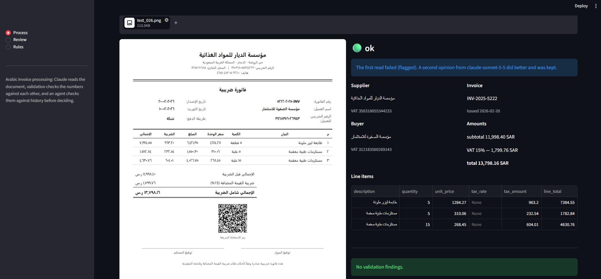
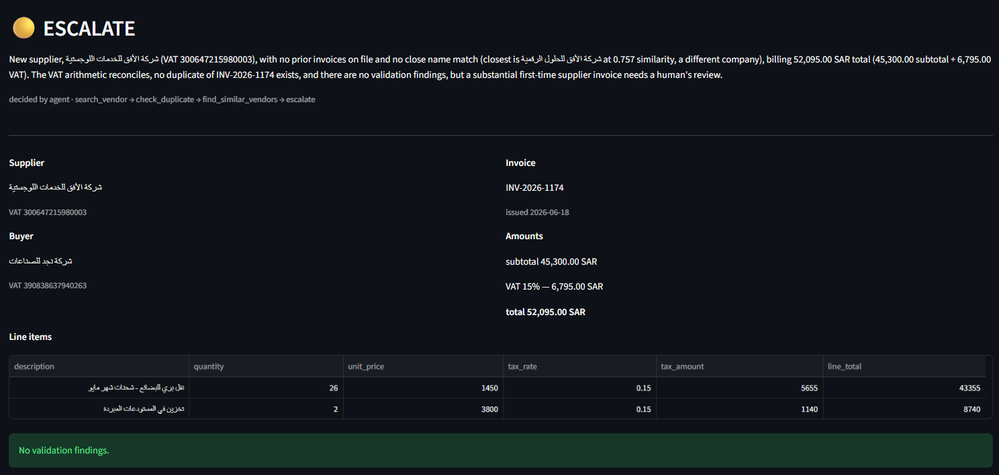
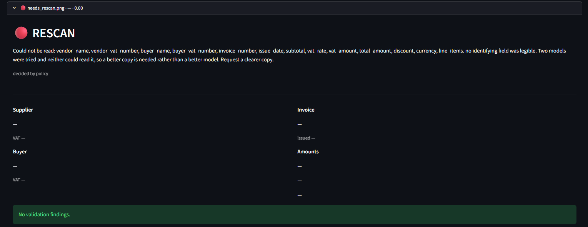
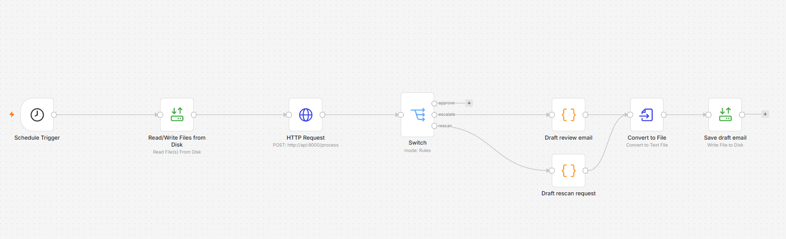
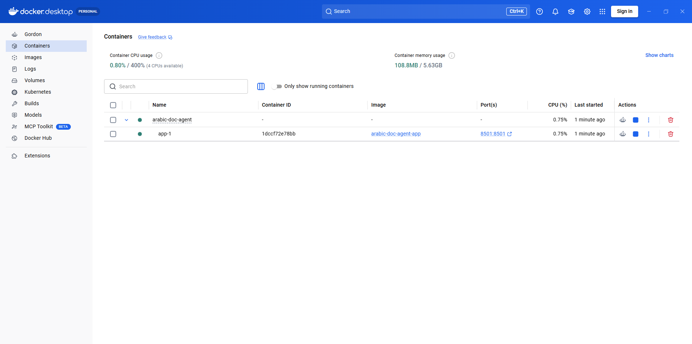

# Arabic Invoice Agent

Reads Saudi tax invoices (فاتورة ضريبية) in Arabic, checks the numbers against
each other and against history, and decides whether to pay them — or refuses,
and says why.

Everything below is measured on a held-out split, and the failures are listed 
alongside the successes.

---

## The problem

An accounts payable team receives invoices as scans and photographs. Someone
opens each one, types the supplier, the number, the date and the amounts into a
system, checks the VAT adds up, checks it isn't a duplicate, and either pays it
or asks a question.

Three things make the Arabic case harder than the usual document-extraction
demo:

- **Two numeral systems.** `١٢٣` and `123` appear on the same page, sometimes in
  the same table.
- **Two calendars.** Hijri and Gregorian, sometimes both, sometimes neither
  labelled.
- **Right-to-left layout with left-to-right numbers**, which means a table's
  columns are not where a model trained mostly on English invoices expects.

And one thing makes it higher-stakes than most extraction tasks: **a misread
digit is a wrong payment.** Not a bad search result — money moved to the wrong
place, for the wrong amount.

That shaped the whole design. The system is built to refuse rather than guess,
and the measurements below are mostly measurements of whether it does.

---

## What it looks like

A document read, with the second model's correction noted:



A decision on a supplier the system has never seen:



A document it could not read, and declined to invent:



The automated intake workflow:



Running as three containers:



---

## How it works

```
image
  │
  ├─ 1. READ        Claude Haiku transcribes the document to JSON
  │                 (an image cache means the same file never costs twice)
  │
  ├─ 2. NORMALISE   Arabic-Indic digits → Western, Hijri → Gregorian,
  │                 Arabic spelling variants folded, money strings parsed
  │
  ├─ 3. VALIDATE    does subtotal + VAT equal the total?
  │                 do the line items add up to the subtotal?
  │                 is the VAT number the right shape?
  │                 is the date reasonable?
  │
  ├─ 4. RETRY       if the first read failed, try again with Claude Sonnet
  │                 and keep whichever result is better
  │
  ├─ 5. DECIDE      policy settles the obvious cases for free;
  │                 everything else goes to an agent with eight tools
  │
  └─ 6. RECORD      invoice, decision, reasoning, tool trace and cost,
                    all appended — nothing is ever overwritten
```

### The model cascade

Haiku reads every document. Sonnet only sees the ones Haiku got wrong — about
one in ten. Haiku costs $0.10/$0.50 per million tokens, Sonnet $2/$10, so the
expensive model is reserved for the documents that actually need it.

On the test split this recovered **28 fields** that the first read would have
lost or got wrong, across 3 of 4 retried documents. The fourth failed both
times — which is itself useful information, because a document that two
different models cannot read is a document problem, not a model problem, and
the system says so in those words.

### Two layers of checking

**Type validation** — if a total cannot be parsed as a number, there is no
usable record, and the pipeline says so.

**Business rules** — the record parses, but something is wrong with it: the VAT
does not match, the line items do not sum to the subtotal, the VAT number
is the wrong shape. These produce findings with a severity, not an exception,
because an invoice with one odd field is still worth a human's attention.

The system handles both VAT-exclusive and VAT-inclusive pricing. That
distinction came from a real retail receipt, where the "subtotal" already
included VAT and the validator called a perfectly correct document an
arithmetic error.

### The agent

Policy decides what it can for free:

| condition | decision |
|---|---|
| nothing readable | `rescan` |
| an error-severity validation finding | `escalate` |
| over 120,000 SAR | `escalate` |
| under 15,000 SAR, clean, not a duplicate | `approve` |

Everything in between goes to an agent with eight tools: `search_vendor`,
`check_duplicate`, `find_similar_invoices`, `find_similar_vendors`,
`get_vendor_history`, and the three decisions it is allowed to make —
`approve`, `escalate`, `rescan`.

It is **not** allowed to return an invoice to the supplier. Accusing a real
company of billing wrongly, on the strength of a model reading a scan, is not a
decision software should make on its own. That option exists only in the review
screen, where a person has the document in front of them.

Policy also holds a veto: if the agent approves something with an
error-severity finding, policy overrides it and the override is recorded.

### Semantic duplicate detection

Exact duplicate checks catch the same invoice number twice. They do not catch
the same work billed twice under a different number with the wording changed.

Each invoice's line item descriptions are embedded locally
(`paraphrase-multilingual-MiniLM-L12-v2`, 384 dimensions, no API cost) and
stored in Chroma. Before deciding, the agent can search for semantically
similar invoices from the same supplier.

Two principles kept this from becoming noise:

- **Don't put in the vector what you can filter exactly.** Supplier, date and
  amount are metadata filters, not part of the embedding. The supplier name was
  in the vector at first, and dominated it so completely that every invoice
  from a company looked identical to every other.
- **Similarity is the last filter, not the first.**

The hard case is telling a double billing from a subscription. A monthly
maintenance contract produces identical invoices, month after month, at
similarity 1.000 — and that is correct. A duplicate detector that flags every
recurring invoice gets switched off in its first week.

Three behavioural fixtures cover this:

| case | similarity | expected | result |
|---|---|---|---|
| same work, reworded, 14 days apart | 0.919 | escalate | escalate |
| 4th monthly instalment at a constant amount | 1.000 | approve | approve |
| 2nd identical invoice, no pattern yet | 1.000 | escalate | escalate |

The last one matters: two points do not establish a rhythm. Two identical
invoices a month apart are as consistent with "the first was never paid" as
with "this is a contract".

### Standing rules

A human resolves an escalation once, records why, and future matching invoices
are decided without them. Rules carry an owner, a reason, a cadence and an
expiry date.

A rule is **evidence the agent weighs, not a bypass.** An earlier version let a
matching rule approve an invoice directly — which also skipped the duplicate
check. A standing exception should lower verification, not remove it.

---

## Results

Two splits of 50 synthetic invoices: 30 dev (used for every decision during
development) and 20 test (held out).

### Accuracy

| | model reads correctly | reaches the database correctly |
|---|---|---|
| **dev** (30 docs) | 98.0% | 95.7% |
| **test** (20 docs) | 97.0% | 93.0% |

*Model accuracy* is what Claude transcribed. *Pipeline accuracy* is what
survived normalisation, validation and the retry — the number that matters,
because it is what a finance system would actually receive.

Per field, on the held-out split:

| field | model | pipeline |
|---|---|---|
| invoice_number | 100.0% | 95.0% |
| issue_date | 100.0% | 95.0% |
| subtotal | 100.0% | 95.0% |
| vat_amount | 100.0% | 95.0% |
| total_amount | 100.0% | 95.0% |
| currency | 100.0% | 95.0% |
| vendor_name | 95.0% | 95.0% |
| buyer_name | 95.0% | 90.0% |
| buyer_vat_number | 95.0% | 90.0% |
| vendor_vat_number | 85.0% | 85.0% |

**Every monetary field was read correctly on all 50 documents.**

Two things to read out of that table:

The pipeline column sits at 95% almost everywhere not because nine separate
things went wrong, but because **one document came back unusable** — and an
unusable document loses all ten of its fields at once. One refusal costs 5% per
field across the board. Both models failed on it, so the document is the
problem.

`vendor_vat_number` is the weakest field at 85%. Fifteen digits, no checksum,
and nothing else on the invoice to cross-check it against. It is also the field
that matters least for payment, which is why it is not in the set the refusal
logic treats as essential.

### Where it struggles

| | documents | accuracy |
|---|---|---|
| Western numerals | 16 | 98.1% |
| Arabic-Indic numerals ٠-٩ | 4 | 92.5% |
| clean scans | 15 | 98.0% |
| degraded scans | 5 | 94.0% |

### Refusals

A document is *unpostable* if the supplier, the invoice number or the total was
read wrong — the three fields you cannot pay without.

| | unpostable | postable |
|---|---|---|
| refused | 1 | 0 |
| accepted | 0 | 19 |

**Precision 1.00, recall 1.00** on both splits. Nothing unusable was accepted;
nothing usable was refused.


### Decision safety

| | approved | approved with a wrong amount |
|---|---|---|
| dev | 15 | **0** |
| test | 5 | **0** |

### What it costs

| | |
|---|---|
| reading one invoice (Haiku) | ~$0.002 |
| one agent decision | ~$0.0015 |
| 40 agent decisions | $0.0601 |
| whole project, 8 days | ~$1.50 |

Policy decides the clear cases without an API call at all. Of 50 documents,
8 were settled by policy for nothing.

The cascade's one weakness: an **unreadable** document is the most expensive
one, because both models run and neither succeeds.

---

## What real invoices broke

The 50 synthetic invoices came from three templates. Four real ones, found
online, broke five things those templates never could — and this is the part of
the project I would talk about first.

1. **English month names.** `12-Nov-2021` parsed to null. The date parser knew
   Arabic month names and numeric formats, not English ones.
2. **VAT-inclusive pricing.** A retail receipt where the subtotal already
   included VAT. Validation reported an arithmetic error on a correct document.
3. **A slash stripped from an invoice number.** `5410/21-008563P1` was stored as
   `541021-008563P1`. The only one of the five that silently **corrupted stored
   data** — the others failed loudly.
4. **Currency assumed to be SAR.** Hardcoded in the prompt. A USD invoice came
   back as riyals.
5. **Mixed tax rates on one invoice.** 15% on some rows, 10% on others. The data
   model could not represent it.

None of these were model failures. Every one was an assumption baked into the
code by the synthetic data — and the synthetic set could not have found any of
them, because it was generated from the same assumptions.

Four real documents found five bugs that fifty synthetic ones could not.

---

## Running it

```bash
git clone https://github.com/SulimanAbusamak/arabic-doc-agent
cd arabic-doc-agent
cp .env.example .env          # add your Anthropic API key
docker compose up -d
```

Then open **http://localhost:8501**.

Three containers start: the Streamlit app, the HTTP API, and n8n. `data/` is
created on first run and holds everything local — the database, the vector
store, and any invoices you process.

### Reproducing the numbers

A fresh clone starts with an empty database. The synthetic invoices and their
ground truth are included, so the accuracy figures above are checkable:

```bash
python src/batch.py            # read all 50   (~$1 in API calls)
python src/embed.py --reset    # build the vector store (local, free)
python src/review.py           # decide all 50 (~$0.06)
python src/evaluate.py dev     # the accuracy tables
python src/evaluate.py test    # the held-out split
```

### The automated workflow

Open **http://localhost:5678**, import `n8n/invoice-intake.json`, and publish
it. Then drop an invoice image into `data/inbox/` and leave it alone.

Within a minute: the file is read, processed, decided, recorded, and moved to
`data/processed/`. If it was escalated or needs rescanning, a draft email
appears in `data/escalations/` addressed to the right person.

### Three ways in, one pipeline

| | for | when |
|---|---|---|
| Streamlit | a person | reviewing, overriding, setting rules |
| CLI | you | batch runs, evaluation, debugging |
| n8n → HTTP API | nobody | a file arrives at 3am |

All three call the same functions and write to the same database. A workflow
that behaves differently from the CLI is a workflow nobody can debug.

---

## Project layout

```
src/
  prompts.py      what Claude is asked for (versioned; the cache keys on it)
  extract.py      the API call, the image cache, cost accounting
  normalize.py    Arabic digits, Hijri dates, money, text folding
  models.py       the Pydantic record and the business rules
  pipeline.py     read → normalise → validate → retry
  agent.py        policy, the agent loop, the veto
  tools.py        the eight tools the agent can call
  rules.py        standing vendor exceptions
  embed.py        local embeddings and Chroma
  database.py     SQLite: invoices, decisions, vendors
  evaluate.py     accuracy, slices, refusal metrics, decision safety
  app.py          the Streamlit UI
  server.py       the HTTP API n8n calls
  batch.py        read everything
  review.py       decide everything
  scenarios.py    the three duplicate-detection fixtures
  generate.py     makes the synthetic invoices
  degrade.py      makes them worse on purpose
n8n/
  invoice-intake.json
```

---

## Decisions worth explaining

**Cheap model first.** Haiku reads everything; Sonnet sees only failures. Ten
times the cost on a tenth of the documents.

**Refuse rather than guess.** Returning nothing is recoverable. Returning a
confident wrong number is not.

**Append, never overwrite.** Every decision is kept. "Why was this paid?" has to
have an answer, including when the answer is "the agent said escalate and a
named person overrode it on this date".

**Structured fields over free text.** A rule's billing frequency should be stored in a dedicated column rather than described in a note. 
In the first version, the note mentioned an "annual maintenance contract,
"which led the agent to assume that only one invoice should be issued per year.
As a result, it incorrectly flagged the second monthly payment as an issue. 
This highlights how relying on written descriptions can lead to misinterpretations, 
as an AI model may understand the same information differently than intended.

**The folder is the queue.** A file in `inbox/` is work to do; a file in
`processed/` is work that's done. No separate record of what has been seen, and
nothing to get out of step after a crash.

**n8n for unattended events, Streamlit for human actions.** A file arriving at
3am needs a scheduler. A person clicking "return to supplier" does not.

**The API is not published to the host.** It has no authentication, so only
other containers can reach it.

---

## Limitations

Things this does not do, or does not do well:

- **Measured on 50 synthetic documents from three templates**, plus four real
  ones. That is a small sample and a narrow one.
- **The test split was evaluated three times** over the project — at prompt v3,
  v4 and the final version. Each run followed changes made against dev only,
  and no change was made in response to a test result. Once would have been
  cleaner.
- **The 15,000 and 120,000 SAR thresholds were chosen by looking at all 50 documents**, 
  including the held-out 20. The right way is to pick them using
  only the dev set. This affects how many invoices were approved or escalated,
  not how accurately any field was read.
- **The duplicate fixtures are injected database records, not rendered
  documents.** They test the agent's reasoning, which was never otherwise
  exercised — but they did not go through a camera.
- **Discounts are captured but not validated.** The field is read; nothing
  checks it against the totals.
- **A split invoice defeats the duplicate detection.** One job billed as three
  smaller invoices scores low on similarity, because the descriptions and the
  amounts genuinely differ.
- **`vendor_vat_number` is the weakest field at 85%**, and nothing on the
  invoice can cross-check it.
- **SQLite is one file and one writer.** Fine for one machine, not for a team.
- **No authentication anywhere.** This runs on a laptop, not a network.
- **The real invoices are not in the repository.** They were publicly available
  samples, and republishing other companies' documents is not something this
  project should do.
- **Bank details are not extracted.** An IBAN is printed on many invoices and
  is not read, stored or checked.

## What would come next

In rough order of value:

1. **Login and PostgreSQL**, so more than one person can use it at once.
2. **Invoices arriving by email** rather than a folder — n8n has an IMAP
   trigger, which would replace the inbox entirely.

3. **Extract the IBAN and flag when it changes.** Altering the bank account on
   an otherwise genuine invoice is among the most common invoice frauds: real
   supplier, real amount, real invoice number, someone else's account. Every
   check here would pass it. The defence is the one the system already does
   for amounts and names — this supplier has used the same account on eleven
   invoices, and this one is different — so it is another field going through
   machinery that exists rather than new machinery.
   
4. **A human-in-the-loop step for rescans**: show the reviewer the document and
   let them transcribe what the model could not, instead of returning it.

5. **Posting approvals to an accounting system**, and emailing the supplier once
   payment is confirmed — not when it is approved.
6. **Claude-drafted correspondence for returns to suppliers.** The internal
   emails are templates and should stay templates; a letter to a supplier needs
   tone, and in Arabic the right register.
7. **More real invoices.** Four found five bugs. Forty would find more.

---

Built by [Suliman Abusamak](https://github.com/SulimanAbusamak).
